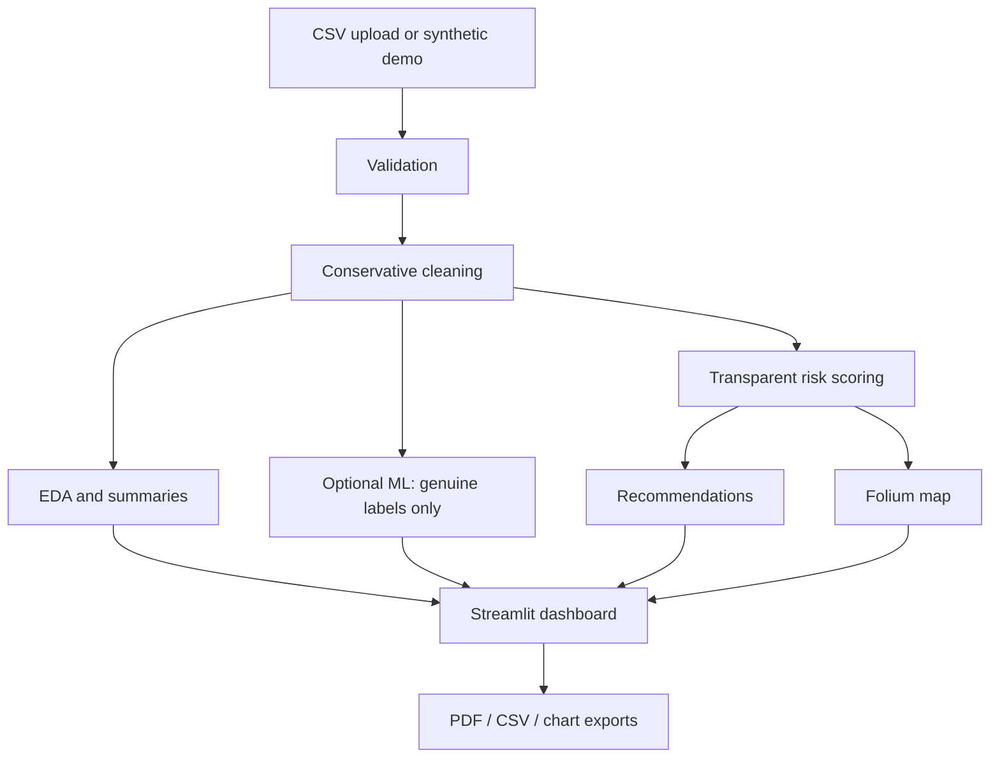

# NutriMap AI – Regional Micro-Nutrient Risk Predictor

A Streamlit public-health planning support application for exploring documented regional environmental, dietary and nutrition indicators. It includes a synthetic demo mode, conservative CSV validation, transparent configurable screening-priority scores, exploratory charts, point-based Folium maps, recommendations, PDF/CSV exports and an optional supervised ML lab.

> **Scientific-use warning:** Scores are configurable planning-priority indicators, not clinical diagnoses or validated disease probabilities. The included sample data are synthetic and do not represent real Pakistani districts or populations. Soil and water mineral concentrations do not establish human nutritional deficiency. Use only documented, representative data and obtain public-health review before operational decisions.

## 1. Run in VS Code (Windows)

```powershell
cd NutriMap_AI
py -m venv .venv
.venv\Scripts\activate
python -m pip install --upgrade pip
pip install -r requirements.txt
streamlit run app.py
```

Open the local URL printed by Streamlit (usually http://localhost:8501).

## 2. Run in Google Colab

Upload/extract the project folder into Colab, then run:

```python
%cd /content/NutriMap_AI
!pip install -r requirements.txt
!streamlit run app.py --server.port 8501 --server.address 0.0.0.0
```

For a browser-accessible Colab session, use your institution's approved port-forwarding method. The app itself is not a notebook widget.

## 3. Dataset workflow

- Start in **Demonstration Mode**; all rows are synthetic and clearly labelled.
- Upload a CSV from the sidebar. Required columns: `Region, Province, District, Latitude, Longitude, Survey_Year`.
- Optional measurements are nullable. Never fill absent measurements with fabricated values.
- Include `Population_Group`, `Measurement_Date`, `Data_Source`, units and method details in your data dictionary or metadata file.
- The cleaning step removes exact duplicates, coerces numeric fields, and marks broad out-of-range values missing rather than clipping them.
- Download the cleaned CSV from **Data Quality & Upload**.

Template: `data/dataset_template.csv`. Demonstration data: `data/sample_data.csv`.

## 4. Scoring methodology

`modules/config.py` contains the display scaling ranges, provisional weights and configurable category boundaries. Each observed indicator is mapped to a 0–100 concern scale; higher values indicate greater concern after applying the configured direction. Available indicators are reweighted to sum to one; missing indicators are omitted and coverage is reported by the underlying function. Environmental soil/water values are intentionally excluded from human-risk scores and treated as context only. These defaults are software demonstration settings, not clinically validated thresholds or evidence-based weights. Change them only with documented expert review.

## 5. Machine learning

The Model Lab trains Decision Tree or Random Forest classifiers only when a real target column (`Anemia_Risk` or `Iodine_Risk`) is supplied. The app does not generate labels from its own scores. A basic random stratified holdout and optional cross-validation are provided as a development baseline. This is not enough to establish generalization; with spatially clustered data, use grouped/geographic or temporal holdouts and external validation before deployment. The current baseline excludes direct outcome prevalence/urinary-iodine proxy fields to reduce leakage. Small datasets are rejected.

Models are saved under `models/` as `.joblib` files. Do not treat model performance on a small convenience sample as clinical validity.

## 6. Maps and geography

Folium maps plot only the latitude/longitude values supplied in the dataset. The current release uses point markers, not fabricated district polygons. A future boundary layer should use a verified official GeoJSON with provenance and matching administrative codes. Never assign district-level measurements from province-level averages.

## 7. Architecture / data flow



Modules: `data_loader.py` loads CSV; `data_cleaning.py` validates and cleans; `data_analysis.py` creates summaries/charts; `risk_scoring.py` calculates transparent scores; `ml_models.py` trains optional supervised models; `risk_map.py` builds interactive point maps; `recommendations.py` creates indicator-aware planning suggestions; `report_generator.py` creates PDF reports.

## 8. Data sources to investigate

| Source | Link | Potential use and cautions |
|---|---|---|
| Pakistan National Nutrition Survey 2018 | https://www.unicef.org/pakistan/reports/national-nutrition-survey-2018 | National nutrition indicators; verify microdata access, survey population, units and geographic release level. |
| Pakistan Demographic and Health Survey | https://dhsprogram.com/ | Survey reports/microdata; variable coverage and access vary by round. |
| WHO Nutrition Landscape Information System | https://www.who.int/data/nutrition/nlis | Country-level nutrition indicators and metadata; do not assume district granularity. |
| ISRIC SoilGrids | https://soilgrids.org/ | Modelled soil properties by depth; verify property, unit, resolution and uncertainty. Not a human nutrition measure. |
| FAOSTAT | https://www.fao.org/faostat/ | Food/agriculture statistics, often national-level; not individual dietary intake. |
| Pakistan Bureau of Statistics | https://www.pbs.gov.pk/ | Official census/statistical publications and survey information. |
| Pakistan Council of Research in Water Resources | https://www.pcrwr.gov.pk/ | Water-quality publications; verify analyte, sampling site/date, units and representativeness. |

The project does not automatically download these datasets or claim specific fields are present. Download/access them through the source's official documentation, then map their verified variables to the template. Keep source, year, population group, method, units and geographic resolution with each record.

## 9. Testing

```bash
python -m unittest discover -s tests -v
```

Tests cover demo loading, required-column validation, duplicate handling, numeric coercion, risk-score creation, missing-input behavior and recommendations. Also manually test CSV upload, filters, map interactions, PDF generation and browser downloads on the machine used for the demo.

## 10. Known limitations / next research steps

- Synthetic demo values are not real observations.
- No official district-boundary GeoJSON is bundled; map uses supplied point coordinates.
- No real trained model is bundled because validated labels were not provided.
- Risk scales/weights are provisional and configurable, not clinically validated.
- Current ML baseline uses random stratified splitting; implement geographic/temporal holdout when data support it.
- Data source links are discovery/documentation starting points; verify each dataset's latest release, licence and variable dictionary.
- Recommendations are population-level planning suggestions, not individual treatment advice.

## 11. Hackathon pitch (about 2 minutes)

“Micronutrient risks are not distributed evenly, but local decision-makers often face fragmented environmental, dietary and nutrition data. NutriMap AI brings documented regional indicators into one transparent planning dashboard. A user can upload a CSV, inspect data quality, explore available nutrition and environmental indicators, and view regional planning-priority markers on an interactive map. The system separates anemia-related and iodine-related indicators, explains which available inputs contribute to each score, and reports when evidence is insufficient. It can suggest population-level next steps such as reviewing iodized-salt access, strengthening nutrition awareness, arranging confirmatory testing, or coordinating screening with qualified public-health teams. Where enough genuine labelled observations exist, the platform can train baseline Decision Tree and Random Forest models and show their evaluation; otherwise, machine learning remains disabled rather than inventing labels. Our demo dataset is synthetic, so it demonstrates the software—not Pakistan's actual district health status. NutriMap AI is a decision-support prototype designed around transparency, geographic honesty and responsible data use.”

## 12. Six-slide presentation outline

1. **Problem:** Fragmented regional nutrition, environmental and dietary information.
2. **Solution:** NutriMap AI workflow and target users (rural health coordinators, agriculture officers, planners).
3. **Data & responsibility:** Sources, metadata, geographic resolution, synthetic demo disclosure.
4. **How it works:** Validation → EDA → transparent scoring → optional ML → recommendations.
5. **Live demo:** Upload, filter, map, regional explorer, PDF export.
6. **Impact & roadmap:** Official data partnerships, verified boundaries, expert-reviewed scoring, spatial/temporal validation.

## 13. One-page project summary

**NutriMap AI** is a regional nutrition-intelligence dashboard that organizes available environmental, dietary and population-health measurements to support public-health planning. It provides conservative dataset validation, transparent configurable anemia/iron and iodine planning scores, interactive point maps, exploratory analysis, indicator-aware recommendations and exportable regional reports. Optional supervised ML is gated on genuine labelled data and minimum sample checks. The application begins with a synthetic dataset solely for software demonstration and is designed to accept verified Pakistan datasets at their supported geographic resolution. It does not diagnose individuals, infer district statistics from provincial averages, or treat soil/water measurements as proof of human deficiency.

## 14. Likely judge questions

**Q: Is the demo data real?** A: No. It is synthetic and labelled as such; it validates the user experience and pipeline only.

**Q: Why not train the model immediately?** A: A supervised model needs genuine outcome labels. Training on invented labels or labels derived from our own score would create circular, misleading performance.

**Q: Does low soil iron mean people are iron deficient?** A: No. Soil and water are contextual environmental measures, not direct human biomarkers.

**Q: Are risk scores medical probabilities?** A: No. They are transparent, configurable planning-priority indicators with provisional weights and display scales.

**Q: What happens when data are missing?** A: Missing indicators are omitted; the score reflects only available eligible inputs and may return “Insufficient data.”

**Q: Why use point markers rather than district polygons?** A: We do not bundle an authoritative boundary file or invent boundaries. Markers use supplied coordinates; a verified GeoJSON can be added later.

**Q: How will you validate the system?** A: Validate source data and units, obtain expert review of scoring, use spatial/temporal holdouts and external validation, and assess calibration and subgroup performance before any operational use.
